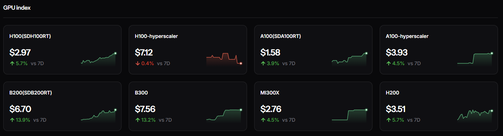
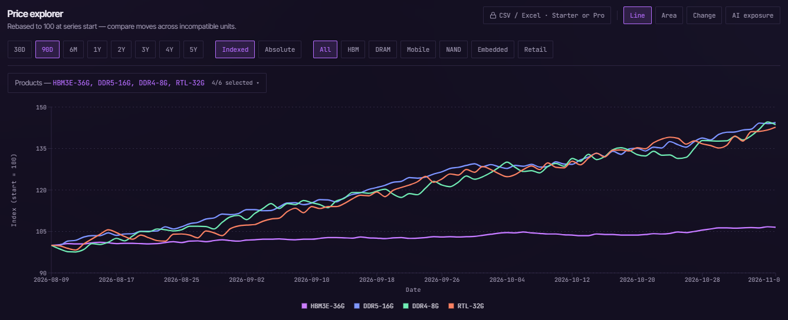
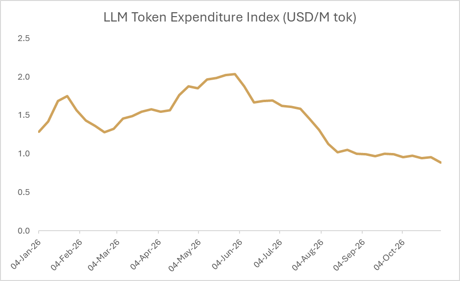
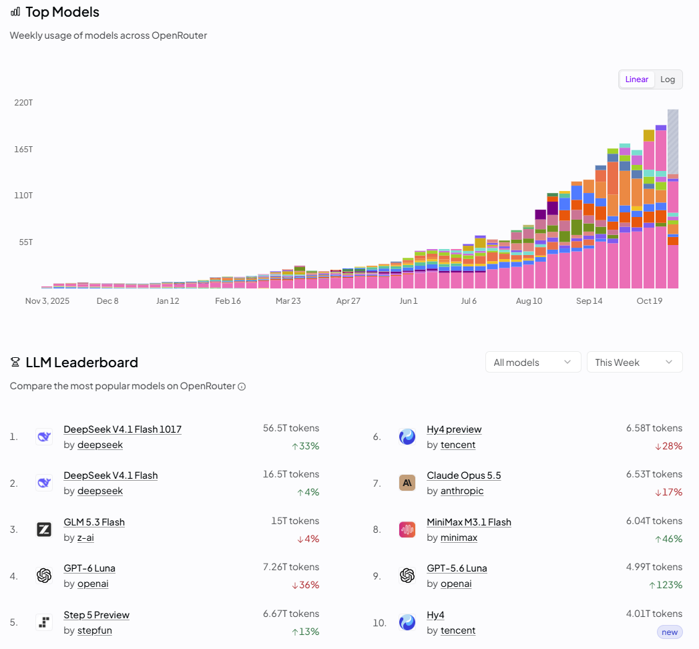
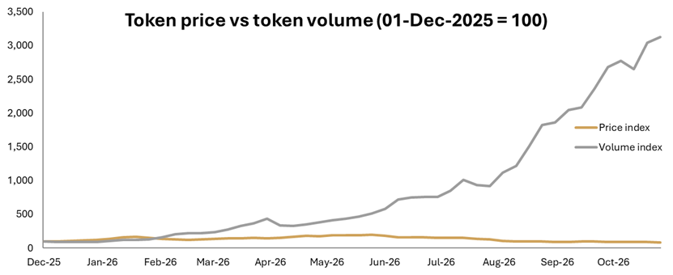
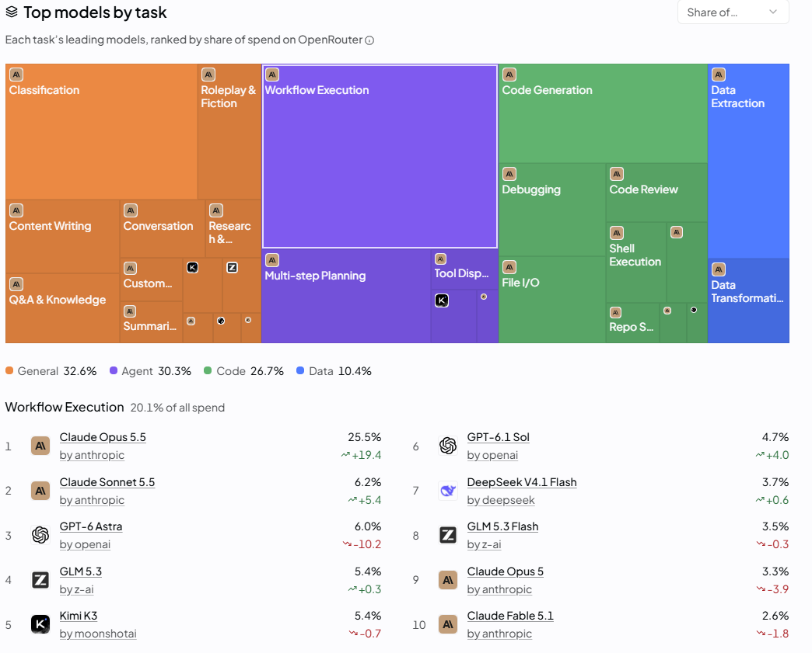
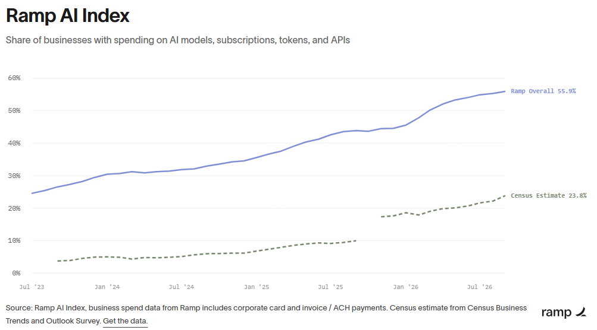
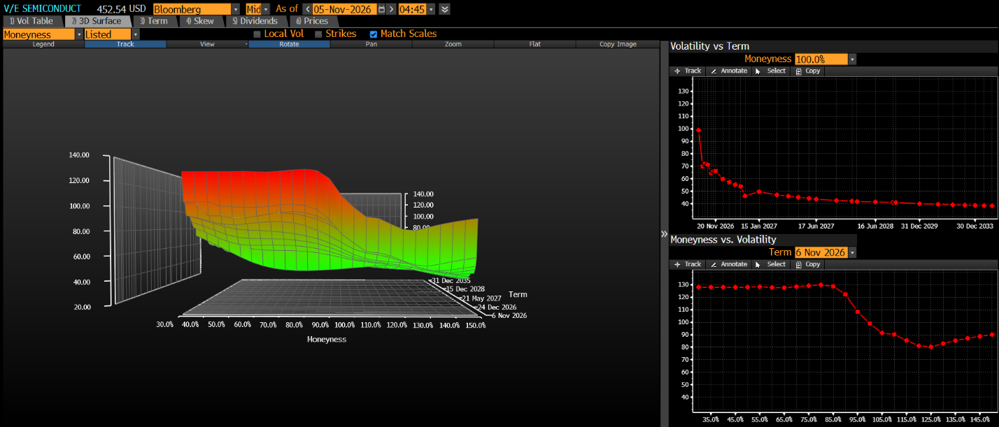

The VanEck Semiconductor ETF fell 15.28% in the week to November 5. But the numbers tell a positive story.

**Compute and memory remain constrained.** Rental prices for Nvidia's latest generation (B300 Blackwell Ultra and B200 Blackwell) are growing at 13% week on week, and even the oldest chip (A100 Ampere) is getting more expensive. That fits the idea that compute is becoming more efficient (current-generation prices are rising fastest) and is still constrained: if you can't get the latest chip, you still buy an older one.

*H100 is Hopper and H200 the upgraded Hopper. Hyperscaler rental is a weaker gauge of GPU demand, because there you also pay for the provider's reliability, ecosystem and contract terms. Source: Silicon Data GPU rental price indices.*

Memory prices also keep climbing.

*Source: DRAM spot and contract prices, memoryindex.io.*

**Jevons paradox in action.** I treat the LLM Token Expenditure Index (USD per million tokens) as a proxy for the cost of intelligence.

*Source: Silicon Data.*

Isn't that bad for the AI trade? How do AI labs become profitable if intelligence gets cheaper? The other side of the equation, token volume, is growing more than enough to compensate.

*Source: OpenRouter LLM rankings.*

Implied token spend (volume × price) has grown 2,574% over the past year. This isn't a precise figure: OpenRouter and Silicon Data are different aggregators with different methodologies. But I'm confident it's directionally right that token volume is rising far faster than token prices are falling. So even if lab margins compress, rising spend keeps capex flowing to the semis.

The OpenRouter figures also don't capture tokens consumed inside AI apps such as Claude Code or Codex. And even on routers like OpenRouter, where tasks can go to open-weights models, most of the spend goes to closed-weights models.

Adoption keeps rising too. As intelligence gets cheaper, ex-US adoption is likely to take off, so the chart below understates the true numbers.

**Hyperscaler capex is not slowing down.** Free cash flow may turn negative and estimates may be missed (things the market doesn't like), but that won't stop the hyperscalers spending: they see AI as a once-in-a-generation opportunity. Capex estimates, which flow to the semis, keep getting revised higher.

| Expected capex growth (QoQ) | Q+1 | Q+2 | Q+3 | Q+4 | YoY |
|---|--:|--:|--:|--:|--:|
| Alphabet | 33% | 4% | 11% | 9% | 67% |
| Microsoft | 16% | 12% | 7% | −1% | 38% |
| Amazon | −38% | 41% | 14% | 8% | 8% |
| Meta | 67% | −14% | 13% | 4% | 68% |
| Oracle | −29% | 6% | 7% | 14% | −9% |
| SpaceX (technically the biggest neocloud) | 79% | 33% | 34% | 16% | 272% |

I've included SpaceX because it is the biggest swing factor for the coming years. By the end of 2027 it plans to build data center capacity roughly equal to everything Google built from 1999 to 2026, a 10GW addition in 2027 alone. Since the Democrats won Texas, the market has turned quite pessimistic about those 10GW, and because SpaceX is such a large swing factor, the worry has spread across the whole sector. Hence the indiscriminate sell-off.

A change in political leadership may slow the build-out, but it won't change the scale of the investment, and regulatory hurdles alone won't make SpaceX halt its data centers. For 2027 at least, most construction has already started with regulatory approval: according to SemiAnalysis, satellite imagery already shows 9GW of data centers under construction. SpaceX is also uniquely placed to scale compute fast because (1) it already owns a lot of land for its factories, (2) its rocket-casting know-how has gone into building gas turbines for behind-the-meter power, and (3) it can draw on Tesla's batteries. On every semis earnings call I've attended, management has said 2027 capacity is already sold out or booked, and the discussion has moved on to 2028–29.

**Expected returns.** Earnings growth is derived from the weighted average capex growth of compute providers.

| | Bear (30%) | Base (60%) | Bull (10%) |
|---|--:|--:|--:|
| Scenario | SpaceX capex halved | 5% industry margin dilution from memory prices and regulatory charges | Capex revised even higher |
| Current EPS | 15.27 | 15.27 | 15.27 |
| 1-yr fwd EPS growth expected | 60% | 60% | 60% |
| 1-yr fwd EPS growth (my case) | 50% | 70% | 100% |
| EPS upside | −10% | 10% | 40% |
| 1-yr fwd P/E | 13.12 | 13.12 | 13.12 |
| Target P/E | 14.29 (5-yr avg − 2 SD) | 18.39 (5-yr avg − 1 SD) | 26.60 (5-yr avg) |
| Valuation rerating | 9% | 40% | 103% |
| Total upside | −2% | 54% | 184% |
| Target price (from 447.7 on Nov 5) | 438.8 | 689.8 | 1,270.4 |

**Probability-weighted target price: 672.6, or 50% upside.**

Implied volatility on puts is much higher than on calls, so many investors are either hedging SMH's downside or betting it falls further. Either way, pricing will stay extremely volatile, so building the position in smaller steps over the next few days is the prudent approach.

**What I'm monitoring:**
- Health of AI demand: GPU and memory prices up, token volume outrunning token price, adoption rising
- Hyperscaler capex
- A change in management tone (hyperscalers and semis) about 2028 and beyond. In my view this would cause the biggest swing.
